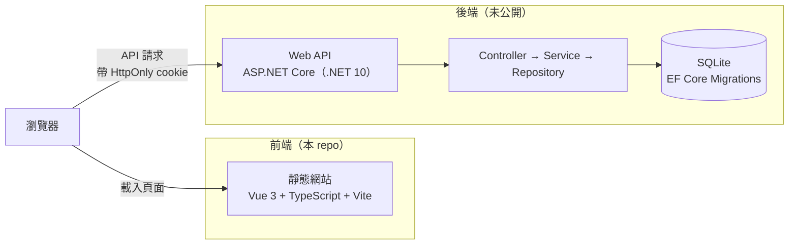
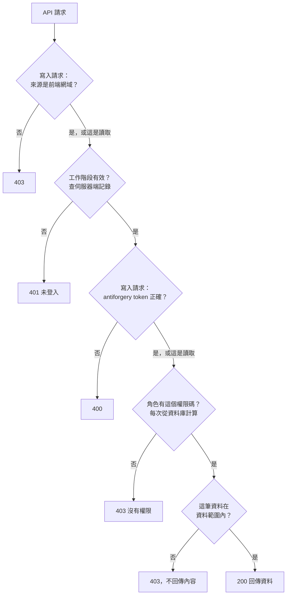
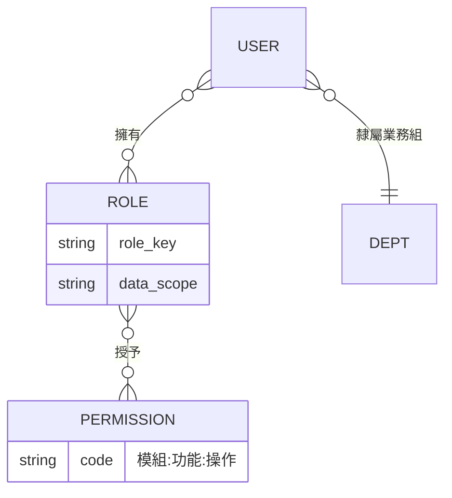

# 權糖 quantang（前端）

權糖是個人作品集展示：一個小而完整的權限與資料範圍範例。情境是虛構的顧問公司「青瀨顧問」的內部專案板，五種角色登入後，看得到、改得到的專案、任務與工時都不一樣。公司、人名與客戶都是假資料。

**線上展示：<https://quantang.heitang.info>**

這個 repo 是展示站的前端原始碼。後端（.NET 10、ASP.NET Core、EF Core）不在這裡公開，但權限與資料範圍的判斷都在後端，所以下面的[架構](#架構)與[權限模型](#權限模型)兩節說明它是怎麼做的。

## 可以試試看

打開線上展示，先看首頁的作品說明，再到登入頁用示範帳號登入。示範資料每 30 分鐘自動重置，可以放心修改。

| 帳號 | 角色 | 登入後看得到什麼 |
| --- | --- | --- |
| admin@quantang.demo | 站台管理員 | 全部 8 個專案、帳號與完整權限矩陣 |
| east.lead@quantang.demo | 業務組主管 | 只有東岸組的 4 個專案 |
| west.lead@quantang.demo | 業務組主管 | 只有西岸組的 4 個專案 |
| owner@quantang.demo | 專案負責人 | 自己負責或被指派的專案，可改任務 |
| advisor@quantang.demo | 顧問 | 被指派的專案，只能改自己的工時 |
| guest@quantang.demo | 參觀訪客 | 唯讀一個公開示範專案與權限矩陣 |

六個帳號的示範密碼都是 `123456`。這是展示用的公開密碼，資料每 30 分鐘重置，請不要在展示站輸入任何真實資料。

幾個可以對照的操作：

- 用東岸與西岸主管各登入一次，看同一個專案列表頁的差別
- 用訪客登入後，把網址的專案編號改成範圍外的，會看到 403 頁
- 用顧問登入，自己的工時可以改，別人的不行

展示站不保證隨時在線。連不上後端時，頁面上方會顯示「展示主機目前離線」，這不是帳號或密碼錯誤。

## 架構



- 前端是純靜態網站，沒有伺服器端程式；所有資料都向後端 API 取得
- 前端只負責顯示。能看到什麼、能改什麼，全部由後端在每一個請求重新判斷
- 後端以 Docker 容器執行；程式推送後先跑自動化測試，通過才部署，新版沒通過健康檢查就不會換上

### 一個請求在後端經過哪些檢查



列表請求沒有最後那個「否」的分支：範圍條件直接寫進資料庫查詢，範圍外的資料根本不會被查出來。

## 權限模型

分成兩層，兩層都通過才看得到資料：

1. **權限碼**決定「能不能做這種事」，例如能不能讀專案
2. **資料範圍**決定「能對哪些資料做」，例如只能讀自己業務組的專案

有範圍但沒有權限碼不行；有權限碼但資料在範圍外也不行。

### 第一層：角色與權限碼（RBAC）



權限碼格式為「模組:功能:操作」。各角色的權限如下，線上展示的「權限矩陣」頁可以看到同一份內容：

| 權限碼 | 含義 | 站台管理員 | 業務組主管 | 專案負責人 | 顧問 | 參觀訪客 |
| --- | --- | :-: | :-: | :-: | :-: | :-: |
| `biz:project:read` | 看專案 | ✓ | ✓ | ✓ | ✓ | ✓ |
| `biz:project:write` | 改專案 | ✓ | ✓ | ✓ | — | — |
| `biz:task:read` | 看任務 | ✓ | ✓ | ✓ | ✓ | ✓ |
| `biz:task:write` | 改任務 | ✓ | ✓ | ✓ | — | — |
| `biz:timeEntry:read` | 看工時 | ✓ | ✓ | ✓ | ✓ | — |
| `biz:timeEntry:writeOwn` | 登記或修改自己的工時 | ✓ | ✓ | ✓ | ✓ | — |
| `biz:timeEntry:writeAny` | 修改他人的工時 | ✓ | — | — | — | — |
| `biz:client:read` | 看客戶 | ✓ | ✓ | ✓ | ✓ | — |
| `biz:permission:matrix` | 看權限矩陣 | ✓ | ✓ | ✓ | ✓ | ✓ |
| `system:*` | 使用者、角色、選單、部門管理 | ✓ | — | — | — | — |

### 第二層：資料範圍

每個角色有一個 `data_scope`，決定該角色的人看得到哪些專案。任務、工時、客戶都跟著專案走。

| 角色 | `data_scope` | 看得到的專案 | 工時 |
| --- | --- | --- | --- |
| 站台管理員 | `all` | 全部 | 範圍內全部 |
| 業務組主管 | `group` | 自己業務組的專案 | 範圍內全部 |
| 專案負責人 | `owned_or_assigned` | 自己負責，或被指派的專案 | 範圍內全部 |
| 顧問 | `assigned` | 被指派的專案 | 只有自己登記的 |
| 參觀訪客 | `public_demo` | 標記為公開示範的專案 | 看不到 |

幾個刻意的設計：

- **列表在資料庫查詢時過濾**。範圍條件是查詢的一部分，不是把全部資料取回來後在程式或前端丟掉
- **範圍外的單筆資料回 403**，不是 404，也不是「HTTP 200 加上錯誤代碼」；回應裡不帶那筆資料的任何內容
- **客戶沒有自己的範圍設定**。一個客戶只有在它底下有你範圍內的專案時才看得到，避免出現兩套可能互相矛盾的規則
- **訪客不能寫入任何東西**，即使某個端點漏了權限檢查，`public_demo` 範圍的寫入也會在更前面被擋下
- **權限不放在 cookie 或前端**。cookie 只用來識別工作階段，角色與權限每次請求都重新計算，改了角色立刻生效

### 用示範資料看這兩層怎麼作用

| 誰 | 做什麼 | 結果 | 原因 |
| --- | --- | --- | --- |
| 東岸組主管 | 開專案列表 | 只有東岸 4 筆 | `group` 範圍 |
| 東岸組主管 | 直接讀西岸的專案 | 403 | 有權限碼，但在範圍外 |
| 顧問 林青 | 開專案列表 | 只有被指派的 1 筆 | `assigned` 範圍 |
| 顧問 林青 | 在被指派的專案登記自己的工時 | 成功 | 有 `writeOwn`，且在範圍內 |
| 顧問 林青 | 修改別人的工時 | 403 | 沒有 `writeAny` |
| 專案負責人 周衡 | 開自己負責的專案 | 看得到全部任務與工時，可改任務 | `owned_or_assigned` 範圍 |
| 參觀訪客 | 開公開示範專案 | 可讀 | `public_demo` 範圍 |
| 參觀訪客 | 讀客戶 | 403 | 沒有 `biz:client:read` |
| 參觀訪客 | 任何寫入 | 403 | 訪客一律不能寫入 |

這些情境在後端都有對應的自動化測試，測的是實際的 HTTP 請求與狀態碼。

### 登入與工作階段

- 登入用 HttpOnly、Secure、SameSite=Lax 的 cookie，前端程式讀不到，也不保存任何權杖
- 工作階段記錄在伺服器端。登出會刪除該筆記錄，登出後即使有人留著同一個 cookie 也只會得到 401
- 寫入請求同時檢查請求來源與 antiforgery token
- 登入連續失敗會被暫時擋下，回 429
- 站台管理員不能修改示範帳號的密碼，也不能修改自己的角色，所以沒有人能把展示站弄到別人登不進去

## 技術棧

- Vue 3（Composition API、`<script setup lang="ts">`）
- TypeScript、Vite
- Pinia、Vue Router
- Tailwind CSS v4
- axios

## 前端做了什麼

- **選單與路由來自後端**：登入後向後端取得可用的選單樹與權限碼，動態註冊路由並渲染側邊選單
- **按鈕依權限顯示**：`v-perm` 指令與 `auth.hasPerm()`；這只是體驗，真正的檢查在後端
- **不保存權杖**：登入用 HttpOnly cookie，請求一律帶 `withCredentials`；使用者資訊每次重整向後端重新讀取
- **寫入請求帶 antiforgery token**：每次寫入前向後端取得 token，放在 `X-CSRF-TOKEN` 標頭
- **錯誤處理集中在一處**（`src/api/request.ts`）：
  - 401：清除登入狀態並回登入頁
  - 讀取被回 403：顯示獨立的 403 頁；寫入被回 403：留在原頁提示
  - 連不上後端：顯示離線橫幅與重試，不清登入狀態
- **首頁純靜態**：未登入可看，不呼叫後端
- **不讓搜尋引擎收錄**：`noindex` meta、`robots.txt` 與回應標頭
- **主題設定**：深淺色、主色與版面選項，登入後隨帳號保存

## 目錄

```
src/
├── api/          # axios 封裝與各 API 呼叫
├── components/   # 共用元件（Modal、分頁、樹狀選單、主題設定）
├── directives/   # v-perm
├── layout/       # 登入後的版面（側欄、頂欄）
├── router/       # 靜態路由、動態路由與導覽守衛
├── stores/       # Pinia：登入狀態、主題
├── utils/        # 訊息提示、連線狀態、樹狀資料工具
└── views/        # 各頁面
public/           # robots.txt 與靜態主機用的 _headers
```

## 本機執行

需要 Node.js 22 與 npm。

```bash
npm ci
npm run dev
```

瀏覽 `http://127.0.0.1:5173`。首頁與登入頁的畫面可以直接看；登入與登入後的頁面需要後端，而後端不在這個 repo。沒有後端時，頁面上方會顯示離線橫幅。

如果你有相容的後端，開發伺服器會把 `/api` 代理到 `http://127.0.0.1:5180`（見 `vite.config.ts`）。

其他指令：

```bash
npm run type-check   # 型別檢查
npm run build        # 建置到 dist/
```

建置時可用環境變數 `VITE_API_BASE` 指定後端位址；未設定時使用相對路徑 `/api`。

## 授權

MIT，見 [LICENSE](LICENSE)。

權限模型（使用者、角色、選單與按鈕權限）的概念參考若依（MIT），程式為自行撰寫。
